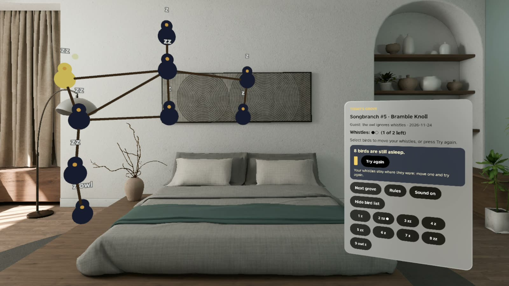
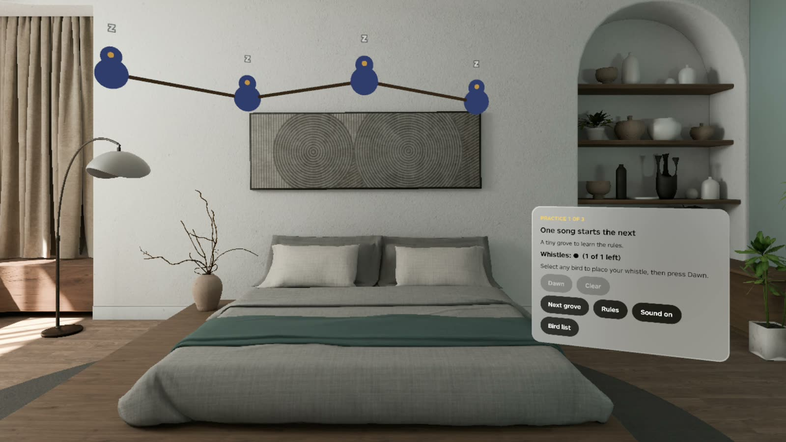

# Songbranch Grove

A daily birdsong puzzle that grows in the room around you. Built for PICO OS 6 with the PICO Spatial SDK, in native Kotlin.


Sleeping birds sit on branches at different heights, about 2 m in front of you. Each bird shows `z`, `zz` or `zzz`: how many singing neighbours it needs before it joins in. You get a few whistles. Select birds to place them, press **Dawn**, and the song spreads along the branches wave by wave, with a tone from each bird's position. Wake the whole grove to win.

- Three practice groves teach the rules by playing.
- **Today's grove** is generated from the date (UTC). Everyone gets the same puzzle each day, offline and without an account.
- Guest birds change the rules for a day: the rooster counts as two singers, the owl ignores whistles, and the lark sings from the start.
- The whistle count is the proven minimum. An exhaustive solver checks every placement, so every grove can be solved and none can be solved with fewer whistles.

## Install

1. Download `songbranch-grove-1.0.apk` from the [latest release](https://github.com/JINGJAYHUANG/songbranch-grove/releases/latest).
2. Start the PICO Emulator, or connect a PICO headset in developer mode. Then run:

   ```
   adb install -r songbranch-grove-1.0.apk
   ```

3. Open **Songbranch Grove** from the app library.

The APK is a debug build of the tagged source, signed with the standard Android debug key. It needs PICO OS 6 (Android API 35). It was tested in the PICO Emulator 6.2.1 on macOS. It has not been tested on a physical headset yet.

## Testing guide (about 3 minutes)

The grove appears about 2 m in front of you, a little to the left. The control panel floats to your front right. Select a bird with the controller ray, with your hand, or with the mouse in the emulator. **Bird list** on the panel shows the same birds as numbered buttons. These buttons are an alternative to selecting birds in 3D.

1. **Practice 1: One song starts the next.** Select the bird at the left end of the branch (bird 1). Press **Dawn**. The song runs down the branch in 4 waves, and the panel shows three stars.
2. Press **Next grove**. **Practice 2: zz needs two.** Put your two whistles on the two `zz` birds (birds 2 and 4). Press **Dawn**. All five birds sing in 2 waves, for two stars. A placement that makes the song last longer earns three stars.
3. Press **Next grove**. **Practice 3: Guests.** Select the owl (bird 2). It refuses the whistle, and the panel explains why. Whistle the rooster instead (bird 1) and press **Dawn**. The rooster counts as two singers and wakes the owl.
4. Press **Next grove** to reach **today's grove**. Its shape, guest bird and whistle count change every day. If birds stay asleep, the panel says how many. Your whistles stay where they were, so you can move one and press **Try again**.
5. **Rules** shows the four rules. **Clear** takes back all whistles. **Sound on** / **Sound off** switches the tones.



## Build from source

You need the PICO Spatial SDK toolchain, installed with the PICO CLI (`pico-cli`): JDK 21 and Android SDK platform 35. The Gradle wrapper (Gradle 8.13) is included. The PICO Spatial SDK (BOM 6.2.8) downloads from the repository listed in `settings.gradle.kts`.

```
./gradlew :engine:test          # rules, solver, daily generator, layout and audio tests
./gradlew :app:assembleDebug    # writes app/build/outputs/apk/debug/app-debug.apk
```

## How it is built

- `engine/` is a pure Kotlin module with no Android dependencies. It is a line-by-line port of the TypeScript engine from Songbranch, our Reddit puzzle game: rules, exhaustive solver, seeded daily generator and scoring. Tests check it bit for bit against `engine/golden.json`, which holds 186 daily groves with every random draw and every simulated dawn. The module also places the grove on an arc around the player (`songbranch.spatial.GroveLayout`) and synthesizes the birdsong (`songbranch.audio.Tones`).
- `app/` is the PICO Spatial SDK app. One `SpatialView` in the default Mixed stage holds the grove and the control panel. The grove uses procedural meshes with unlit materials, colliders, hover highlight and spatial tap. The panel is an attachment. Coroutines time each dawn wave. The tones are written once as small WAV files in private storage and play from object-audio emitters at the waking birds.
- Everything in the scene is drawn from code. The launcher icon and an unused sample model (`app/src/main/assets/box.usdz`) come from the PICO Spatial project template.
- AI assistance: the app was built with Claude Code (Anthropic) as the coding agent, together with the PICO CLI and its agent plugin for project setup, the emulator, screen capture and diagnostics. The tests above were written and run along the way.



## Privacy

The app has no network permission, no accounts and no analytics. It stores only the generated tone files in its private storage.

## License

Apache License 2.0. See [LICENSE](LICENSE).
